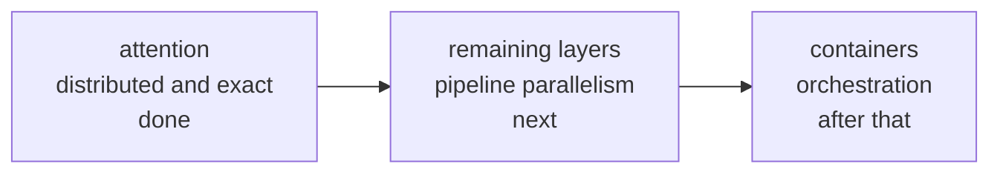
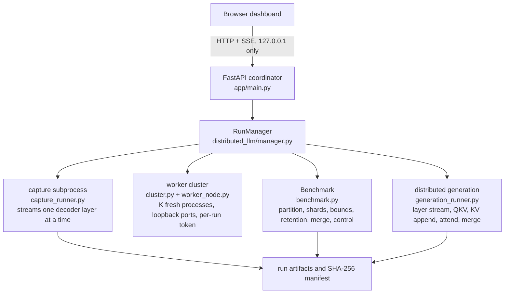

# Tessera

A tessera is one tile in a mosaic: meaningless alone, exact when set beside its
neighbours. That is the design here. Each worker owns one tile of the
computation, attention today and whole layer ranges later, and the coordinator
reassembles the tiles into the same result a single machine would have produced.

Tessera is a framework for running LLM inference across edge devices. Attention
is the first target because it is the dominant cost: its work grows quadratically
with context length, which is exactly where a single edge device runs out of
memory and time. This repository already captures Q/K/V from
**Qwen2.5-Coder-1.5B**, partitions attention across independent worker processes,
merges the results exactly, and decodes tokens through that same split. The
remaining layers, container packaging, and multi-node orchestration are the next
stages, tracked in the [roadmap](docs/08-roadmap.md).

The intent is a working framework, not a demo. It is a side project, and the
current deployment is deliberately one host with loopback workers so every
number is reproducible, but nothing in the worker contract depends on that:
workers are ordinary HTTP processes with a per-run token and no shared memory, so
they can move to separate devices as the transport and orchestration work lands.

The browser dashboard starts a run, streams progress, and shows measured errors,
retention decisions, FLOP accounting, logs, and downloadable artifacts.

The framework is not a simulator. Every attention number it reports in the
dashboard and the results below is computed from Q/K/V tensors captured from the
pinned model snapshot, partitioned across real worker processes, and merged by
the coordinator. A separate, labeled synthetic sweep tests the pruning mechanism
on planted data; it never feeds the dashboard or the results table. Text
generation uses a second worker cluster: a layer-streamed Qwen2 decoder uploads
every K/V vector to the worker that owns its token position, sends every
attention query to all workers, and merges the replies with an exact float64
log-sum-exp. No monolithic model forward pass produces the generated text.

## What is measured, and what is not

| Component | Status |
|---|---|
| Q/K/V for the final token, all 28 layers, both KV heads | Captured in fp32 from the pinned checkpoint, streamed one layer at a time |
| Attention capture fidelity | Verified against Hugging Face `Qwen2DecoderLayer` in tests |
| Token partition, block bounds, retention, distributed merge | Executed over loopback HTTP workers, one isolated process per worker |
| Reference attention | Dense computation on the captured arrays on the coordinator |
| Reported relative error and certified error | Computed per layer and KV head, with disjoint and overlap controls |
| Text generation | Greedy decoding through a second worker cluster; KV cache lives on the workers, every layer is evaluated there |
| Generated-token fidelity | Verified token-for-token against `Qwen2ForCausalLM` greedy decoding on a tiny Qwen2 model |

The web server never loads PyTorch. Capture and generation run in separate
subprocesses that exit before their worker clusters are torn down, which returns
model memory to the operating system.

## Current results

Two measured runs define the present state. Both come from the machine described
in [docs/06-operations.md](docs/06-operations.md): Windows 11, Python 3.12, CPU only.

Benchmark, 2026-10-24, 243 context tokens, 4 workers, overlap 0,
`epsilon = 1e-3`:

| Metric | Value |
|---|---|
| Layers x KV heads | 56 units |
| Exact merge relative error | 4.26e-14 |
| Disjoint control relative error | 4.26e-14 |
| Certified error at full retention | 0.0 |
| Mean retained fraction | 1.0 (all 4 workers retained everywhere) |
| Peak attention mass | 34.05 percent |
| Attention entropy | 4.29 bits |
| Net FLOP savings | -1.85 percent (overhead, not savings) |
| Capture / benchmark wall | about 26 s / about 9 s |
| Capture peak RSS | 594 MB |

End-to-end distributed generation, 2026-10-25, run `20261025T011641Z-run-983071bf`,
3 workers, 1021 prompt tokens, 1000 generated tokens:

| Metric | Value |
|---|---|
| Status / stop reason | completed / `max_new_tokens` |
| Prefill | 169.216 s |
| Decode | 7933.702 s, 7.93 s per token |
| Generation total | 9188.21 s (about 2 h 33 m) |
| Run duration | 9271.625 s |
| Decoder peak RSS | 728.6 MB |
| Output | 4821 characters |

The merge is exact to floating point across process boundaries, and a 1000-token
decode ran to completion with the KV cache living only on the workers. The
remaining bottleneck is the layer-streamed decoder reloading weights for every
token, not the distributed attention step, which is why distributing the other
layers is the next stage.

## Finding: certified pruning does not trigger on dense attention

The 2026-10-24 benchmark retained all four workers in every unit at
`epsilon = 1e-3`. The retention curve for layer 0, KV head 0 shows why:

| Retained workers | Certified error | Actual relative error |
|---|---|---|
| 1 | 9.617 | 0.258 |
| 2 | 9.617 | 0.154 |
| 3 | 9.617 | 0.082 |
| 4 | 0.0 | 4.26e-14 |

The Cauchy-Schwarz block bound loses a factor that grows with
`sqrt(head_dim)`. At `head_dim = 128` the bound stays above 9 even when three of
four workers are retained and the true error is already below 0.1. The protocol
therefore refuses to prune at strict tolerances, and the exact distributed path
(full retention, zero overlap) is the working configuration. The framework
reports this result instead of relaxing the certificate or hiding the overhead.

### Why the prototype pruned

The prototype's scenarios plant a token whose score against the query is
`log(N) + margin`. That is a property of the generator, not of attention. The
repository now reproduces the construction as a labeled synthetic diagnostic:

```bash
python -m distributed_llm.scenario_sweep --out-dir output/sweeps/needle
```

Every combination runs through a fresh worker cluster and the real certificate.
Measured at 64 tokens, one needle, `epsilon = 1e-3`, overlap 0, pseudorandom:

| Margin | Workers | Retained | Certified | Online % | Charged % |
|---|---|---|---|---|---|
| no needle | 4 | 4.00/4 | 0.0 | -7.01 | -64.15 |
| 2.5 | 2 | 2.00/2 | 0.0 | -3.88 | -61.03 |
| 6 | 2 | 1.00/2 | 8.1e-4 | 45.31 | -11.83 |
| 6 | 4 | 2.00/4 | 8.6e-4 | 48.42 | -8.73 |

The needle-free control retained every worker in all 8 control cells, so the
certificate is not accepting arbitrary data. The collapse belongs to the planted
scenario, and the charged column shows that one bounds pass can still erase the
saving. The real-prompt result above is unchanged. Details and the full grid are
in [docs/02-protocol-math.md](docs/02-protocol-math.md) and
[docs/06-operations.md](docs/06-operations.md).

## Roadmap

Three stages. The checkboxes are the todo list; [docs/08-roadmap.md](docs/08-roadmap.md)
carries the design notes and the open questions behind them.



### Stage 1: attention

- [x] fp32 Q/K/V capture from the pinned checkpoint, verified against Hugging Face
- [x] partitioned attention with Cauchy-Schwarz block bounds
- [x] certified omitted-mass bound and greedy retention
- [x] exact float64 merge with a disjoint control
- [x] strided KV ownership and exact distributed greedy decode
- [x] per-run process isolation, typed errors, hashed artifacts, auth, limits
- [ ] bounds tight enough to prune at `head_dim = 128`, the measured blocker
- [x] overlap correction validated beyond the disjoint control

### Stage 2: the rest of the layer stack

- [ ] pipeline parallelism: assign layer ranges to workers and stream activations between stages
- [ ] activation transport over the same authenticated, size-capped binary channel as KV
- [ ] micro-batching and scheduling that keep every pipeline stage busy
- [ ] token-for-token equivalence against the monolithic model, as attention already has
- [ ] KV cache placement that follows the layer-owning worker

### Stage 3: edge deployment

- [ ] one container image per role: worker and coordinator
- [ ] orchestration: discovery, placement, health checks, restart, drain
- [ ] multi-host transport with TLS and per-node credentials
- [ ] memory- and bandwidth-aware placement across heterogeneous devices
- [ ] sampling and continuous batching beyond greedy decode
- [ ] measurements on real edge hardware instead of loopback processes

## Documentation

The reference set lives in [`docs/`](docs/00-index.md). The files are numbered in
reading order, from the process model to the numerical contract to running and
testing the framework; read them in that order if you are new to the codebase.

| Document | Covers |
|---|---|
| [docs/00-index.md](docs/00-index.md) | what the framework is, current results, glossary, and the reading order |
| [docs/01-architecture.md](docs/01-architecture.md) | process model, run lifecycle diagrams, stage placement, isolation boundaries |
| [docs/02-protocol-math.md](docs/02-protocol-math.md) | partitioning, bounds, certificate, merge, decode invariants, FLOP model |
| [docs/03-worker-protocol.md](docs/03-worker-protocol.md) | every worker endpoint, NPZ field sets, status codes, idempotency |
| [docs/04-coordinator-api.md](docs/04-coordinator-api.md) | HTTP API, auth modes, SSE event shapes, artifacts, error taxonomy |
| [docs/05-configuration.md](docs/05-configuration.md) | every environment variable, validator rules, worked examples |
| [docs/06-operations.md](docs/06-operations.md) | measured costs, RAM admission, failure modes, artifact verification |
| [docs/07-testing.md](docs/07-testing.md) | what each test file protects, markers, CI behavior |
| [docs/08-roadmap.md](docs/08-roadmap.md) | what runs today, what comes next, and the open questions for each stage |

The diagrams are Mermaid, which GitHub renders inline.

## Architecture



Each run gets its own directory, session id, worker processes, bearer token, and
event stream. Workers are terminated when the run ends. Only one run may be
active at a time.

### Protocol summary

1. Tokenize the prompt and reject it if it exceeds the selected context length.
   Silent truncation is never benchmarked.
2. Capture `q_last`, `keys`, and `values` for every layer and KV head in fp32.
3. Partition token positions across `K` workers by pseudorandom hash or
   contiguous chunks. Optional overlap creates secondary copies.
4. Each worker computes centroid and radius per block and returns local softmax
   statistics. The coordinator computes Cauchy-Schwarz upper bounds.
5. Greedy retention keeps workers by descending bound until
   `2 * V_max * p_pruned <= epsilon` for every query head, using a safety factor
   `gamma` (default 1.05).
6. Retained workers return local maxima, denominators, and outputs. The
   coordinator merges with a stable log-sum-exp and applies a multiplicity
   correction of `-log(c)` for tokens retained `c` times.
7. A disjoint control repeats the merge on a different worker set. It must match
   the dense reference to floating point, which catches protocol errors that a
   self-consistent certificate would miss.

### Distributed generation protocol

1. A fresh worker cluster is started with its own session and bearer token. The
   coordinator checks RAM for the KV cache plus the decoder's measured peak.
2. The decoder streams the final norm and LM head at start, then one transformer
   layer at a time from `model.safetensors`. It never keeps the full fp32 model
   resident and never stores a KV cache.
3. Every KV vector is uploaded to the worker that owns its token position:
   `position % K == worker_id`. Each `(layer, KV head)` tracks its own positions,
   keys, and values, so layer-by-layer streaming appends are unambiguous.
4. Prefill uploads all prompt positions in one append per layer. Each decode step
   uploads one position. Appends are idempotent for byte-identical retries and
   reject conflicting duplicates, missing units, foreign positions, non-finite
   values, and shape errors.
5. Every attention query is sent to all workers as a binary NPZ payload. Workers
   apply the causal mask locally, return local maxima, denominators, outputs,
   visible-key counts, and owned-key counts.
6. The coordinator merges the replies with a stable float64 log-sum-exp and
   verifies two invariants on every call: the visible key count for each query
   equals `position + 1`, and each worker's owned-key count matches the strided
   ownership formula.
7. The next token is the argmax of the tied LM head, evaluated in vocabulary
   chunks so logits never require a full-vocabulary allocation. Decoding is
   greedy and deterministic.

## Requirements

- Python 3.12 (tested with 3.12.4 on Windows 11; the CI workflow targets 3.12 on
  Ubuntu)
- The pinned snapshot in the local Hugging Face cache, about 3.1 GB:

  ```bash
  hf download Qwen/Qwen2.5-Coder-1.5B \
      --revision df3ce67c0e24480f20468b6ef2894622d69eb73b
  ```

  The framework uses `local_files_only=True` and refuses to run if the snapshot
  is missing or incomplete. It never downloads weights implicitly.
- Capture requires `LAB_MIN_AVAILABLE_RAM_GB` (0.45 GB by default) and
  `LAB_MIN_FREE_DISK_GB` (1 GB by default). Starting the cluster additionally
  requires about 0.25 GB plus 72 MB per worker. The full 243-token run peaked at
  594 MB resident during capture.
- Distributed generation needs the decoder's peak resident memory
  (`LAB_GENERATION_DECODER_HEADROOM_GB`, 0.7 GB by default) plus the KV cache.
  The measured decoder peak on this machine was about 0.9 GB with a short prompt;
  each worker holds only its strided share of the KV cache.

## Install and run

```bash
python -m venv .venv
# Windows
.venv\Scripts\activate
# Linux or macOS
source .venv/bin/activate

pip install -r requirements.txt
```

Start the server:

```bash
./launch.sh fast        # Linux or macOS, skips dependency installation
launch.bat fast         # Windows, skips dependency installation
```

Without `fast`, the launchers install the pinned requirements first. Both bind
to `127.0.0.1` only and never enable auto-reload. To run the server directly:

```bash
python -m uvicorn app.main:app --host 127.0.0.1 --port 8000
```

Open `http://127.0.0.1:8000`. The first run with the default 512-token limit
takes about a minute on a CPU-only machine: roughly 26 seconds of capture and 9
seconds of benchmark for a 243-token prompt.

The dashboard exposes prompt, workers, context tokens, overlap, strategy, seed,
tolerance, safety factor, distributed generation toggle, and the number of new
tokens. Context tokens for the probe are capped at `LAB_MAX_CONTEXT_TOKENS`
(1024 by default). A prompt that needs more tokens than the selected limit fails
with `prompt_too_long` instead of being truncated. Generation is greedy and
layer-streamed, so expect roughly 10 to 15 seconds per new token on this
machine, plus prefill time proportional to the prompt.

## Authentication and security

The default local mode has no login: the server issues a signed HttpOnly
session cookie to loopback clients. Set `LAB_API_KEY` to require a key. The
dashboard then shows a login overlay, and `POST /api/session` exchanges the key
for the cookie. Scripts can send `Authorization: Bearer <key>` instead.

`LAB_SESSION_SECRET` should be set to a long random value when the API key is
enabled. If unset, a random secret is generated per process, which invalidates
cookies on restart. API keys and worker tokens are never logged or written to
artifacts.

In addition:

- Host allowlist (`127.0.0.1`, `localhost`, `::1` by default) and origin checks
  for unsafe methods.
- Request body limit of 1 MiB for the JSON API.
- Signed, expiring, same-site strict cookies with an 8-failure login lockout.
- Strict input validation with Pydantic (`extra="forbid"`).
- Browser security headers including CSP, `X-Content-Type-Options`,
  `X-Frame-Options`, and no-store caching.
- Artifact downloads restricted to a fixed filename whitelist with path
  containment checks.
- Capture and worker request timeouts, disk and RAM preflight, cancellation,
  and one active run.
- Prompts are deleted unless `LAB_STORE_PROMPTS=true`. The summary records only
  a SHA-256 hash.

## Configuration

| Variable | Default | Meaning |
|---|---|---|
| `LAB_OUTPUT_DIR` | `./output` | Root for run directories |
| `LAB_MODEL_ID` | `Qwen/Qwen2.5-Coder-1.5B` | Pinned model |
| `LAB_MODEL_REVISION` | `df3ce67c...` | Pinned revision |
| `LAB_API_KEY` | empty | Enables API key authentication |
| `LAB_SESSION_SECRET` | empty | Cookie signing secret |
| `LAB_STORE_PROMPTS` | `false` | Keep `prompt.txt` after a run |
| `LAB_ALLOWED_HOSTS` | `127.0.0.1,localhost,::1` | HTTP Host allowlist |
| `LAB_MIN_WORKERS` / `LAB_MAX_WORKERS` | `2` / `8` | Worker bounds |
| `LAB_DEFAULT_WORKERS` | `4` | Dashboard default |
| `LAB_MAX_CONTEXT_TOKENS` | `1024` | Upper bound for a probe |
| `LAB_MAX_OVERLAP_PCT` | `50` | Overlap ceiling |
| `LAB_MAX_PROMPT_CHARS` | `12000` | Prompt character limit |
| `LAB_MAX_CONCURRENT_RUNS` | `1` | Active run limit |
| `LAB_SESSION_TTL_S` | `900` | Cookie lifetime |
| `LAB_CAPTURE_TIMEOUT_S` | `900` | Capture subprocess timeout |
| `LAB_WORKER_REQUEST_TIMEOUT_S` | `180` | Per-request worker timeout |
| `LAB_MIN_FREE_DISK_GB` | `1.0` | Preflight disk headroom |
| `LAB_MIN_AVAILABLE_RAM_GB` | `0.45` | Capture preflight RAM floor |
| `LAB_SAFE_GAMMA` | `1.05` | Certificate safety factor |
| `LAB_MAX_GENERATION_TOKENS` | `4096` | New-token ceiling per run |
| `LAB_DEFAULT_MAX_NEW_TOKENS` | `1000` | Dashboard and API default |
| `LAB_MAX_GENERATION_POSITIONS` | `4096` | Ceiling on prompt plus generated tokens |
| `LAB_GENERATION_TIMEOUT_S` | `1800` | Generation setup and prefill allowance |
| `LAB_GENERATION_STEP_TIMEOUT_S` | `30` | Per-token watchdog allowance |
| `LAB_GENERATION_DECODER_HEADROOM_GB` | `0.7` | Decoder peak admission headroom |
| `LAB_MAX_CAPTURE_ARTIFACT_MB` | `192` | Capture size cap |

## API

Public endpoints: `GET /`, `GET /healthz`, `GET /readyz`,
`GET /api/public-config`, `POST /api/session`, `POST /api/logout`.

All other `/api` routes require a session cookie or bearer key:

| Method | Path | Purpose |
|---|---|---|
| `GET` | `/api/status` | Counters, current run, limits |
| `GET` | `/api/metrics` | Process and run metrics |
| `POST` | `/api/runs` | Start a run, returns 202 |
| `GET` | `/api/runs/current` | Current or most recent run |
| `GET` | `/api/runs/{id}` | Run status |
| `POST` | `/api/runs/{id}/cancel` | Request cancellation |
| `GET` | `/api/runs/{id}/events?after=N` | SSE stream with replay |
| `GET` | `/api/runs/{id}/result` | Summary JSON |
| `GET` | `/api/runs/{id}/artifacts` | Available artifact list |
| `GET` | `/api/runs/{id}/artifacts/{name}` | Download a whitelisted artifact |

A run request accepts:

```json
{
  "prompt": "string",
  "workers": 4,
  "max_tokens": 512,
  "overlap_pct": 0.0,
  "strategy": "pseudorandom",
  "seed": 42,
  "error_tol": 0.001,
  "safe_gamma": 1.05,
  "generate": false,
  "max_new_tokens": 1000,
  "layers": null,
  "kv_heads": null
}
```

`layers` and `kv_heads` optionally restrict the benchmark to a subset for quick
probes. Worker counts outside `LAB_MIN_WORKERS..LAB_MAX_WORKERS`, a token limit
outside `16..LAB_MAX_CONTEXT_TOKENS`, unknown fields, and overlapping runs are
rejected. The captured prompt token count plus `max_new_tokens` must fit inside
`LAB_MAX_GENERATION_POSITIONS`; a run that would exceed it fails before decoding
starts. That window is separate from `LAB_MAX_CONTEXT_TOKENS`, which still bounds
the captured attention context used by the benchmark. The generation watchdog
budget is `LAB_GENERATION_TIMEOUT_S + max_new_tokens *
LAB_GENERATION_STEP_TIMEOUT_S`, so a long decode is not killed by a flat timeout
and a short one is not left hanging. A requested generation that fails fails the
run; it is never silently skipped.

## Artifacts

Each run directory under `output/runs/<run_id>/` contains:

| File | Contents |
|---|---|
| `request.json` | Validated run configuration and prompt hash |
| `capture.json` | Model geometry, token count, capture timing, peak RSS |
| `capture.npz` | Captured `tokens`, `q_*`, `k_*`, `v_*` arrays in float64 |
| `benchmark.json` | Per-unit bounds, retention curves, errors, FLOPs, timings |
| `cluster.json` | Worker session summary, requests, retries, bytes |
| `summary.json` | Dashboard payload, aggregate metrics, provenance |
| `events.jsonl` | Structured event log with sequence numbers |
| `generation.json` | Generated token ids, text, per-step margins, decoder and transport timings, worker status, or a typed error |
| `manifest.json` | SHA-256 and byte size for every other artifact |
| `cluster/workers/*.log` | Benchmark worker stdout and stderr |
| `generation_cluster/workers/*.log` | Generation worker stdout and stderr |
| `capture.stderr.log` | Capture subprocess stderr |
| `generation.stderr.log` | Generation subprocess stderr |

The manifest is written last and is not hashed into itself.

## Command line

Capture only:

```bash
python -m distributed_llm.capture_runner \
    --prompt-file prompt.txt \
    --max-tokens 512 \
    --out output/cli/capture.npz \
    --meta output/cli/capture.json
```

Use `--tokens-json tokens.json` instead of `--prompt-file` for pre-tokenized
input. `--layers 0,1` and `--kv-heads 0` restrict capture. Truncated prompts are
rejected by default; `--allow-truncation` exists only for offline analysis and
is never used by the server.

Benchmark a capture:

```bash
python -m distributed_llm.benchmark_runner \
    --capture output/cli/capture.npz \
    --meta output/cli/capture.json \
    --out-dir output/cli \
    --workers 4 \
    --overlap 0 \
    --eps 1e-3
```

Both runners emit one JSON event per line on stdout. The coordinator parses the
same protocol in `RunManager`, so CLI failures and server failures share the
same error taxonomy.

## Tests and CI

```bash
python -m pytest
```

The suite covers the numerical protocol, worker HTTP API, cluster lifecycle,
capture equivalence with Hugging Face (including a tiny random Qwen2 model built
on the fly), distributed generation equivalence against `Qwen2ForCausalLM`
greedy decoding through a real worker cluster, a real-model generation check,
benchmark integration, and application security. Real-model tests use the pinned
snapshot when it is cached and skip otherwise. Markers: `real_model` and
`integration`.

CI in `.github/workflows/ci.yml` runs Python 3.12 with the pinned requirements,
compiles the package, and runs the suite. It does not download the model, so
real-model tests skip there.

## Known limitations

- The benchmark itself is final-token and attention-only. Distributed generation
  exercises KV caching across decode steps but decodes greedily, at full
  retention, without sampling or pruning. The certified pruning path is measured
  separately in the benchmark stage.
- Layer streaming keeps the decoder inside this machine's RAM at the cost of
  speed. Each new token reloads all 28 layers from disk, so generation is much
  slower than a resident-weight runtime. The artifacts report the measured cost.
- Certified pruning is sound but too loose to help at `head_dim = 128` with
  dense attention. The framework shows the measurement rather than claiming
  savings.
- Workers communicate over loopback and hold shards in memory. There is no
  transport encryption, remote deployment, or persistence beyond run artifacts.
- One run at a time, no queue. Additional requests receive HTTP 409.

## Legacy files

`main.html` is the original static prototype and `folder/` plus `transformers/`
are empty leftover directories. None of them are served or imported. They are
kept only for reference and can be deleted safely.
