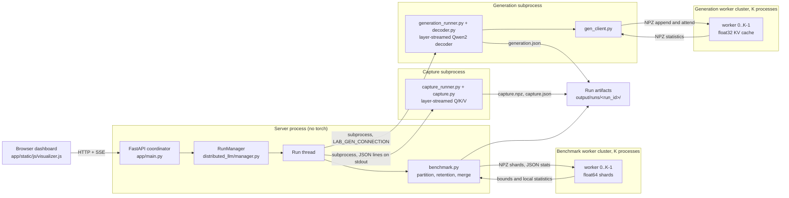
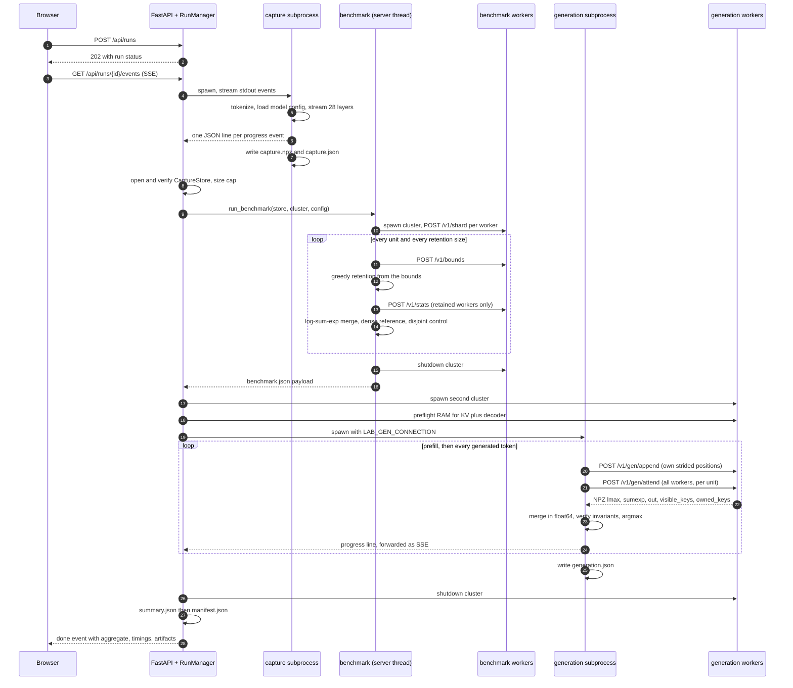
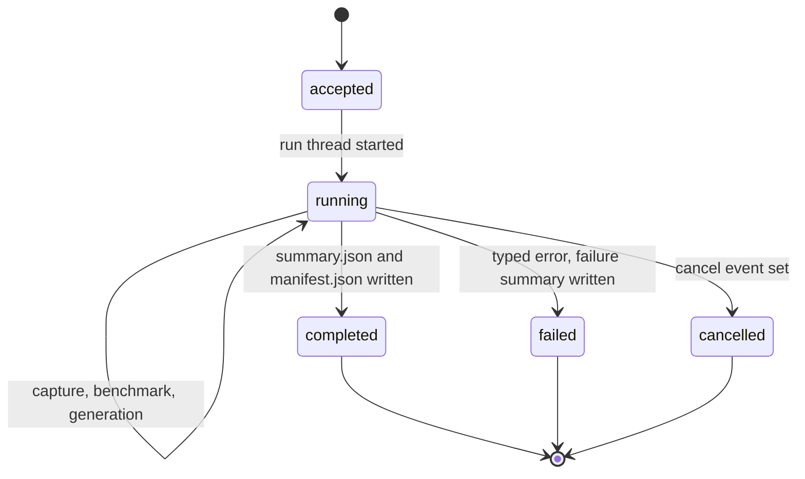
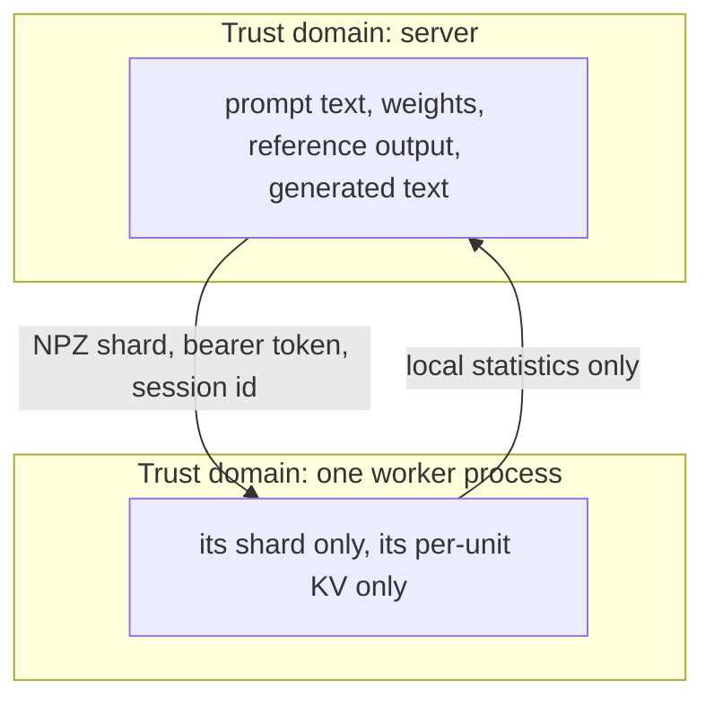

# Tessera architecture

## Process model

Tessera is one web process, up to two model-bearing subprocesses, and two
clusters of worker processes. Nothing in the web process ever imports PyTorch.

| Process | Lives | Holds | Talks to |
|---|---|---|---|
| `app.main:app` (uvicorn, 127.0.0.1) | whole session | no weights, no tensors | browser (HTTP + SSE), subprocesses, workers |
| `distributed_llm.capture_runner` | capture stage | one decoder layer at a time, the tokenizer | disk (writes `capture.npz`), the manager over stdout |
| `distributed_llm.generation_runner` | generation stage | the layer-streamed Qwen2 decoder, no KV cache | its worker cluster over loopback HTTP, the manager over stdout |
| benchmark workers (`worker_node`) | benchmark stage | prompt shards as float64 K/V plus centroid and radius | the coordinator over loopback HTTP |
| generation workers (`worker_node`) | generation stage | per-unit generation cache as float32 K/V | the decoder over loopback HTTP |

The two clusters are separate. They get different session ids, different bearer
tokens, different ports, and different run subdirectories (`cluster/` and
`generation_cluster/`), so a leaked token from one never opens the other.

## Run lifecycle

One run at a time. `RunManager.start()` rejects a second request with HTTP 409
before any process is spawned, and the whole pipeline below executes in a single
worker thread so the server keeps answering the browser while a run is live.

## Run states

A run is never left half-reported. The failure path writes a failure summary
with the exception type and message, then a manifest, then the terminal `done`
event with `status: "failed"`. A cancelled run does the same with
`status: "cancelled"`. Generation failure is a run failure: there is no path that
reports attention numbers and quietly omits the text.

## Stage placement

| Stage | Code | Where it executes | Why |
|---|---|---|---|
| Capture | `capture_runner.py`, `capture.py` | subprocess | PyTorch must be able to leave memory when capture ends |
| Partition, upload, bounds, retention, merge | `benchmark.py` via `cluster.py` | server run thread | NumPy only, no model weights |
| Decode | `generation_runner.py`, `decoder.py`, `gen_client.py` | subprocess | holds streamed weights, still no KV cache locally |
| Attention math | `protocol.py` | wherever the caller is | pure float64 NumPy, no I/O, so it is directly testable |
| Worker kernels | `worker_node.py` | worker process | sees only its shard, its session, its token |

## Subprocess contract

Both model-bearing subprocesses speak the same line protocol on stdout: one
JSON object per line, with a `stage` key. The manager forwards a line whose
`stage` matches the label it is watching, treats `stage: "done"` as the
completion record, and turns `stage: "error"` into a typed failure carrying
`error_type` and `message`. Stderr is redirected to `capture.stderr.log` or
`generation.stderr.log` and never parsed. The same protocol is what the CLI
emits, so a failure seen in the dashboard is reproducible by hand with the same
error taxonomy.

The subprocess environment is fixed by `_stream_subprocess`: `PYTHONUNBUFFERED=1`,
`PYTHONIOENCODING=utf-8`, `TOKENIZERS_PARALLELISM=false`, and the
`USE_TF`/`USE_FLAX`/`TRANSFORMERS_NO_TF` guards that stop transformers probing
optional backends. Generation additionally receives `LAB_GEN_CONNECTION`, a
JSON blob with the session id, the bearer token, and the worker base URLs. It is
passed by environment, never written to an artifact or a log.

## Isolation boundaries

A worker rejects a shard, an append, or an attend whose session id is not the one
it booted with (HTTP 403), and rejects any body without its bearer token (401).
Ownership is checked on the worker as well as the client: an append that contains
a position the worker does not own is refused with 403, so a coordinator bug
cannot silently cross-contaminate shards. `gen_client.py` refuses to connect to a
worker URL that is not loopback HTTP, which keeps a tampered connection blob from
turning the decoder into an exfiltration client.

The full contract is in [03-worker-protocol.md](03-worker-protocol.md).

## Module map

| Module | Responsibility |
|---|---|
| `app/main.py` | routes, session auth, static dashboard, artifact downloads |
| `app/security.py` | signed cookie session, host and origin guards, body limits, login lockout |
| `app/templates/index.html`, `app/static/js/visualizer.js` | dashboard, SSE client, charts |
| `distributed_llm/config.py` | every limit, every environment variable, the validator |
| `distributed_llm/manager.py` | run lifecycle, subprocess orchestration, artifacts, event stream |
| `distributed_llm/capture*.py` | Q/K/V capture from the pinned snapshot, one layer at a time |
| `distributed_llm/cluster.py` | benchmark worker lifecycle plus HTTP client for shards, bounds, stats |
| `distributed_llm/worker_node.py` | the worker HTTP service and its kernels |
| `distributed_llm/benchmark.py` | the certified-pruning benchmark loop and its accounting |
| `distributed_llm/protocol.py` | pure numerical core: partitioning, bounds, statistics, merge, certificates |
| `distributed_llm/decoder.py` | layer-streamed Qwen2 decoder plus distributed attention |
| `distributed_llm/gen_client.py` | binary loopback client for the generation cache |
| `distributed_llm/generation_runner.py` | greedy decode loop, artifacts, invariant reporting |
| `distributed_llm/logging_utils.py` | structured event log, RSS and RAM probes |
