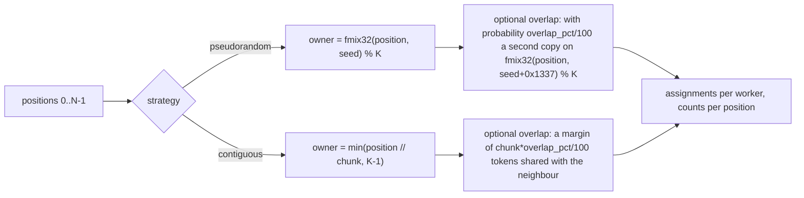
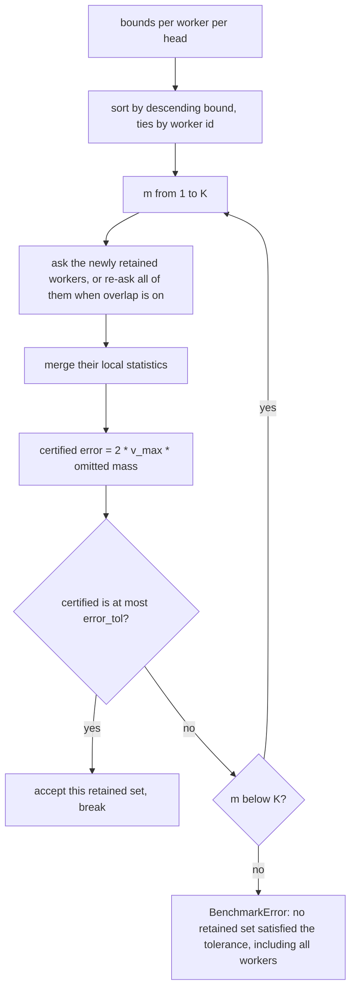
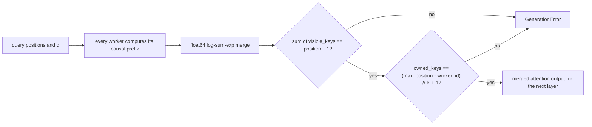

# Numerical protocol

Everything here lives in `distributed_llm/protocol.py`, which is pure float64
NumPy with no HTTP and no model code, precisely so the equivalence and bound
properties can be tested directly. Workers import the kernels, the coordinator
imports the merges, and both call the same functions.

Conventions: `N` prompt positions, `K` workers, `H` query heads per KV group
(`q_per_kv`, 6 for Qwen2.5-Coder-1.5B), `d` head dimension (128), and
`scale = 1/sqrt(d)`.

## Ownership and partitioning



`fmix32` is the MurmurHash3 32-bit finalizer, seeded with `0x977F23A7`. It is
implemented bit-identically to the earlier JavaScript prototype, so historical
partition tables remain comparable.

Invariants asserted inside `partition_tokens` on every call:

| Check | Failure |
|---|---|
| every position has at least one copy | `AssertionError: partition left tokens uncovered` |
| `primary_worker` recomputed matches the assignment pass | `AssertionError: primary assignment is not deterministic` |
| argument ranges, `N >= 1`, `K >= 1`, `0 <= overlap <= 100`, known strategy | `ValueError` with the specific complaint |
| `contiguous` requires `N >= K` | `ValueError: contiguous partitioning requires n_tokens >= workers` |

Multiplicities are counted per position, never per vocabulary id. A prompt that
repeats the same token at two positions has two distinct softmax entries, and
collapsing them would silently change the denominator.

## Block bounds

For each unit `(layer, kv_head)` and each worker, the shard stores a centroid and
a radius at upload time:

```
centroid = mean(keys, axis=0)
radius   = max ||key - centroid||
bound(head) = (q[head] . centroid + ||q[head]|| * radius) * scale
```

That is Cauchy-Schwarz over the whole block, so it upper-bounds every score in the
block at once. It is therefore a bound on the maximum, which is what pruning needs,
and it is loose by construction: the looseness grows with `sqrt(d)`, and that is
the whole story of the measured result below.

The query must be unnormalised. Normalising it here would make the bound
incompatible with the real scores, which also use the raw query.

## Retention, certificate, and correction



The coordinator sorts workers by descending `max over heads` bound (ties broken by
worker id, so the order is deterministic) and walks `m = 1..K`:

1. Ask the newly retained workers for local statistics, or re-ask all retained
   workers when overlap is enabled. Incremental accumulation is only valid at
   `overlap_pct == 0`, because with overlap the `-log(c)` correction for a
   position changes when its second copy becomes retained.
2. Merge into a candidate output.
3. Compute, per head, the omitted mass over positions with zero retained copies:

```
z_pruned  = gamma * sum over pruned unique tokens of exp(upper_bound - max_retained_score)
omitted   = z_pruned / (z_retained + z_pruned)
certified = 2 * v_max * omitted
```

`v_max` is the largest value-vector norm in the unit, taken from the dense
reference. `gamma` is `LAB_SAFE_GAMMA`, default 1.05. `safe_exp` clamps at
exponent 700 and maps `-inf` to exactly 0.0 so an empty block cannot raise. A
non-finite denominator returns 1.0 when there is pruned mass and 0.0 when there is
none, which is the conservative direction.

4. Accept the first `m` with `certified <= error_tol`. If none qualifies, including
   `m = K`, raise `BenchmarkError: no retained set satisfied the tolerance,
   including all workers`. Full retention yields zero omitted mass, so this error
   means the certificate is unsatisfied even at complete retention, which cannot
   happen by construction and therefore signals a real defect.

### Overlap correction

A position retained `c` times contributes `exp(score - log c)`
per copy, so the `c` copies sum to exactly the unreplicated mass. `token_log_correction`
supplies the `-log c` term, `retained_multiplicities` counts the copies over the
retained set only, and the worker drops the correction entirely for the `primary`
subset, where each position appears exactly once by construction.

## Soundness check

For the selected set, the coordinator compares the merged output against the dense
reference computed on the coordinator from the same captured arrays:

```
actual   = || dist_out - full_out ||
allowed  = certified + 1e-8 * (1 + || full_out ||)
```

Any `actual > allowed` raises `BenchmarkError: soundness check failed at layer L
kv H`. This is the property the certificate claims, checked rather than assumed,
per unit and per head.

## Disjoint control

After selection, every worker is queried again with `subset: "primary"` and no
multiplicity correction, and the merged result must match the dense reference to a
relative error below `1e-8`. The control uses a different selection of rows (each
position exactly once, by owner) than the retained path (each copy of a retained
position), so a self-consistent but wrong correction cannot pass it. It is the
check that would catch a partition bug that the certificate, which is computed
from the same bounds that the bug corrupted, would happily certify.

## Merge

The merge is a two-level stable log-sum-exp. With per-worker maxima `m_w`,
denominators `s_w`, and locally normalised outputs `o_w`:

```
M = max_w m_w
weight_w = s_w * exp(m_w - M)
out = sum_w weight_w * o_w / sum_w weight_w
```

Subtracting the global maximum keeps every exponent at or below zero, so no
overflow is possible. Workers with no contribution report `m_w = -inf`, `s_w = 0`,
`o_w = 0` and are excluded explicitly rather than through `exp(-inf - (-inf))`,
which would produce NaN. `merge_worker_stats` merges `(workers, heads)` statistics
for a single query, `merge_stats_batch` returns only the outputs, and
`merge_causal_stats` handles the batched decode case where the statistics are
`(workers, queries, heads)`.

## Distributed causal attention (decode)

The decode path replaces hash-based selection with strided ownership: position `p`
lives on worker `p % K`, exactly once, per unit. The worker kernel
`causal_local_stats_batch` masks by position rather than by index:

```
visible[key, query] = key_position <= query_position
scores  = einsum(q[query, head, :], keys) * scale, masked to -inf
lmax    = max over visible keys
out     = (exp(scores - lmax) @ values) / sum(exp(scores - lmax))
```

Keys, values, and positions are appended in sorted order and a query batch is
strictly increasing in position, so the visible prefix is contiguous and the mask
is a prefix condition, not a full matrix scan, in intent. Both sides validate the
sortedness on ingress; unsorted or duplicated positions are 422.



Two invariants are verified by the decoder on every attend round trip:

| Invariant | Why it catches real bugs |
|---|---|
| `sum over workers of visible_keys[query] == query_position + 1` | any lost, duplicated, or wrongly routed key breaks the softmax denominator |
| `owned_keys == (max_position - worker_id) // K + 1` | proves strided routing stored each key up to the window on exactly one worker |
| merged denominator `> 0` and merged output finite for every query head | a query that saw no key anywhere, or a NaN anywhere in the merge, stops the decode |

A mismatch raises `GenerationError`, and a run that raises fails. There is no path
where the decode continues on a broken cache.

## FLOP accounting

`benchmark.py` counts arithmetic, not wall time, and reports it per unit:

| Term | Formula | Meaning |
|---|---|---|
| baseline | `H * N * (4d + 3)` | dense attention for the query |
| bounds | `K * H * (2d + 2) + H * (2d + 1)` | per-worker dot and norm work, plus query norms |
| stats | `H * occurrences * (4d + 3)` | real attention over retained rows, counting selection work actually performed |
| merge | `retained * H * (2d + 1)` | weighted combination |

`savings = 100 * (1 - distributed / baseline)` per unit, and
`net_flop_savings_pct` uses the totals across units. `occurrences` is the reason a
pruned run can still lose: incremental selection queries each retained worker once
in bound order, so a selection at `m = K` costs the same row count as the dense
baseline plus the bounds stage, which is a net loss.

## The measured result: pruning does not trigger

A full run on 2026-10-24, 243 context tokens, 4 workers, overlap 0, `epsilon =
1e-3`:

| Retained workers | Certified error | Actual relative error |
|---|---|---|
| 1 | 9.617 | 0.258 |
| 2 | 9.617 | 0.154 |
| 3 | 9.617 | 0.082 |
| 4 | 0.0 | 4.26e-14 |

The certificate is valid and useless at this geometry: it stays above 9 while the
true error is already under 0.1, so the protocol retains every worker and reports
`-1.85` percent net FLOP savings, meaning pure overhead. Exact merge error and
disjoint control error are both 4.26e-14, which is float64 round-off, so the
distributed path is numerically correct and the pruning idea is what fails.

The framework reports this instead of relaxing the certificate, tightening
`gamma`, or silently switching to a tolerance the data cannot meet. If you change
the bound estimator, expect that 4.26e-14 and a mean retained fraction of 1.0 to
move, and add a test that states which one you intend to move.
