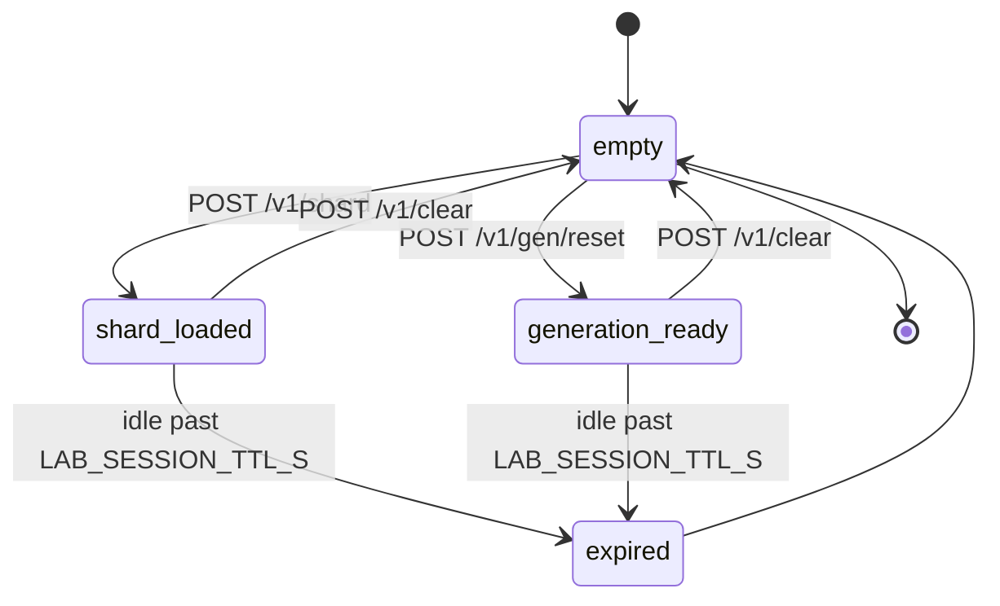
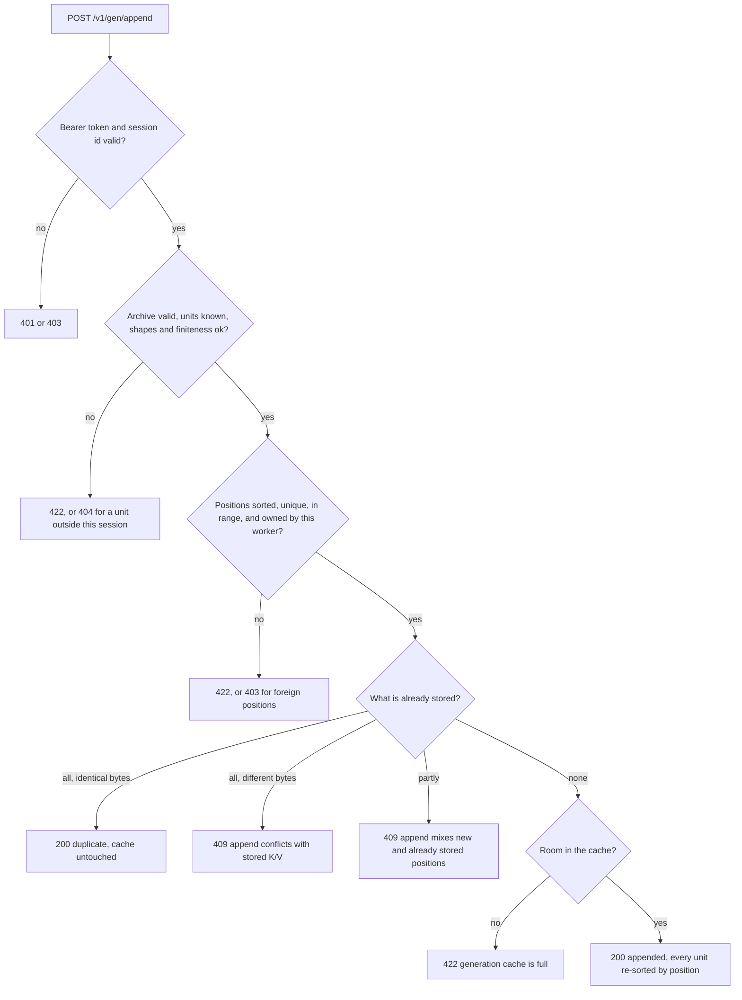

# Worker HTTP protocol: attention and KV cache

Reference for `distributed_llm/worker_node.py`, Tessera's isolated attention
worker. One process serves one shard for one session on one loopback port. It
never sees the full prompt, the model weights, or the reference output.

Clients: `cluster.py` (benchmark stage) and `gen_client.py` (generation stage).

## Boot contract

```bash
LAB_WORKER_TOKEN=... LAB_SESSION_ID=... LAB_WORKER_ID=0 \
    python -m distributed_llm.worker_node 43101
```

| Input | Source | Rule |
|---|---|---|
| `LAB_WORKER_TOKEN` | env | at least 16 characters, else the process exits |
| `LAB_SESSION_ID` | env | at least 8 characters, else the process exits |
| `LAB_WORKER_ID` | env, default `0` | integer, matched against every request's `worker_id` |
| port | `argv[1]`, else `LAB_WORKER_PORT`, else `8001` | 1..65535 |
| `LAB_READY_FILE` | env, optional | the process writes `{"worker_id", "port", "pid"}` here on startup and deletes it on exit |

The ready file is how `cluster.py` knows a worker is listening, and the pid lets
it detect a worker that died during startup and surface the last 20 log lines.

uvicorn is started with `host="127.0.0.1"`, `log_level="warning"`,
`access_log=False`, `timeout_keep_alive=10`, `limit_concurrency=64`. Docs,
ReDoc, and the OpenAPI endpoint are all disabled.

## Authentication and session isolation

Every endpoint except `GET /health` requires `Authorization: Bearer <token>`,
compared with `hmac.compare_digest`. A missing or wrong token is 401 and
increments the `rejected` counter.

Body or query `session_id` must equal the id the worker booted with. A mismatch
is 403 with detail `session mismatch`. This is the rule that makes a cross-run
request impossible even if a token leaks.

Query `worker_id`, where present, must equal the worker's own id, else 403
`worker id mismatch`.

## Body size limits

| Path | Limit | Constant |
|---|---|---|
| `/v1/shard` | `LAB_MAX_REQUEST_BYTES`, default 80 MiB | `limits.max_request_bytes` |
| `/v1/gen/*` | 32 MiB | `MAX_GENERATION_BYTES` |
| everything else | 4 MiB | `MAX_JSON_BYTES` |

Enforced twice: a `reject_oversized` HTTP middleware checks `Content-Length`
before the handler runs, and `_read_body` counts streamed bytes so a request that
lies about its length still gets 413. An unparsable `Content-Length` is 400.

## State and TTL

Two pieces of live state, both optional: `shard` (benchmark) and `generation`
(the decode cache). `live_shard()` returns 409 `no shard loaded` when absent and
410 `session expired` when `time.monotonic() - last_access >= LAB_SESSION_TTL_S`
(default 900 s), in which case the state is dropped. `live_generation()` behaves
the same for the decode cache with detail `generation session expired` and
`no generation session initialized`. Successful access refreshes `last_access`.
`POST /v1/clear` drops both immediately.



A single `threading.RLock` serialises all state access and all kernels, so a
worker never sees a half-written shard.

## Endpoint index

| Method | Path | Auth | Purpose |
|---|---|---|---|
| `GET` | `/health` | no | liveness, version |
| `GET` | `/v1/status` | yes | identity, sizes, counters |
| `POST` | `/v1/shard` | yes | load a benchmark shard (NPZ) |
| `POST` | `/v1/bounds` | yes | Cauchy-Schwarz upper bounds (JSON) |
| `POST` | `/v1/stats` | yes | local softmax statistics (JSON) |
| `POST` | `/v1/gen/reset` | yes | create an empty decode cache |
| `POST` | `/v1/gen/append` | yes | store K/V for owned positions (NPZ) |
| `POST` | `/v1/gen/attend` | yes | causal local attention over the cache (NPZ) |
| `POST` | `/v1/clear` | yes | drop all state |

## GET /health

No auth, no parameters.

```json
{"status":"alive","service":"attention-worker","version":"11.4.2"}
```

## GET /v1/status

No body. Returns the fields `cluster.py` uses to verify worker identity and
`gen_client.py` uses for its final status sweep. Secrets are never included: no
token, and the session id is only returned so the coordinator can match identity.

```json
{
  "worker_id": 0, "session_id": "...", "version": "11.4.2",
  "uptime_s": 12.34, "rss_mb": 71.2,
  "loaded": true, "token_count": 64, "primary_count": 17,
  "layers": [0, 1], "kv_heads": [0, 1], "head_dim": 128,
  "generation_loaded": false, "generation_positions": 0,
  "generation_units": 0, "generation_head_dim": 0,
  "bytes_received": 1048576,
  "counters": {"uploads": 1, "bounds_calls": 0, "stats_calls": 0,
               "gen_resets": 0, "gen_appends": 0, "gen_attend_calls": 0,
               "gen_tokens": 0, "rejected": 0, "bytes_received": 1048576}
}
```

## POST /v1/shard

Query parameters: `worker_id` (0..4096), `session_id` (8..128 chars),
`layers` and `kv_heads` as comma-separated integers, `q_per_kv` (1..64).

Body: an NPZ archive (`allow_pickle=False`) with:

| Array | Dtype on read | Shape | Meaning |
|---|---|---|---|
| `tokens` | int64 | `(N,)` | token positions, sorted and strictly increasing, all >= 0 |
| `primary` | bool | `(N,)` | positions this worker owns outright, at least one |
| `k_{layer}_{kv}` | float64 | `(N, head_dim)` | keys for that unit |
| `v_{layer}_{kv}` | float64 | `(N, head_dim)` | values for that unit |

Validation, in order: valid archive and all named arrays present (400),
`1 <= N <= LAB_MAX_CONTEXT_TOKENS` (422), metadata length (422), positions sorted
and unique and non-negative (422), non-empty primary set (422), consistent K/V
shapes with `N` rows (422), `head_dim` identical across units and inside
8..4096 (422), all values finite (422). Re-uploading replaces the loaded shard
and resets its clock.

On success the worker computes, per unit, the centroid `mean(keys, axis=0)` and
the radius `max ||key - centroid||`, which is all the information the bound query
needs later. Keys and values are kept as float64.

Response:

```json
{"status":"loaded","worker_id":0,"token_count":64,"primary_count":17,
 "layers":[0,1],"kv_heads":[0,1],"head_dim":128,"bytes":1048576}
```

## POST /v1/bounds

JSON body (Pydantic `ShardRequest`). Note the asymmetry with the coordinator:
`ShardRequest` does not set `extra="forbid"`, so unknown fields are silently
ignored here, while `POST /api/runs` rejects them. Validation still covers every
field that matters.

```json
{"session_id":"...","layer":0,"kv_head":1,
 "q":[[0.0, 0.0]],"multiplicities":null,"subset":"assigned"}
```

| Field | Rule |
|---|---|
| `session_id` | 8..128 chars, must match the worker session |
| `layer` | 0..1024 |
| `kv_head` | 0..256 |
| `q` | matrix of exactly `(q_per_kv, head_dim)`, all finite, at most `LAB_MAX_QUERY_HEADS` rows |
| `multiplicities` | optional, capped at `LAB_MAX_MULTIPLICITY_ENTRIES` on `/v1/stats` |
| `subset` | `"assigned"` or `"primary"` |

Returns one upper bound per query head: `(q . centroid + ||q|| * radius) * scale`
with `scale = 1/sqrt(head_dim)`. The query must not be normalised; the bound and
the real scores both use the raw query.

```json
{"worker_id":0,"bounds":[9.61, 9.44],"token_count":64,"elapsed_ms":0.412}
```

`layer`/`kv_head` not in the shard is 404.

## POST /v1/stats

Same body as `/v1/bounds`. `subset: "primary"` restricts the computation to
positions this worker owns and discards the multiplicity correction; `subset:
"assigned"` uses every stored position and applies `-log(c)` for a position
retained `c` times.

```json
{"worker_id":0,"layer":0,"kv_head":1,
 "lmax":[4.2, 4.1],"sumexp":[11.3, 10.9],
 "local_out":[[0.1, 0.2],[0.3, 0.4]],
 "token_count":64,"elapsed_ms":0.881}
```

`local_out` is `(q_per_kv, head_dim)` per query head, already divided by the
local denominator; the coordinator's merge treats it as a weighted average.

## POST /v1/gen/reset

Query parameters only: `worker_id`, `session_id`, `num_workers` (1..4096),
`layers`, `kv_heads`, `q_per_kv` (1..64), `head_dim` (8..4096),
`max_positions` (1..32768).

Checks: `worker_id < num_workers` (422), `max_positions <=
LAB_MAX_GENERATION_POSITIONS` (422). Then it allocates, for each `(layer,
kv_head)` unit, empty int64 `positions` and empty `(0, head_dim)` float32 `keys`
and `values`.

```json
{"status":"initialized","worker_id":0,"num_workers":3,
 "layers":[0,1],"kv_heads":[0,1],"q_per_kv":6,"head_dim":128,"max_positions":2048}
```

## POST /v1/gen/append

Query parameters: `worker_id`, `session_id`. Body: NPZ with `positions` (1-D
integer array, sorted, strictly increasing, inside `0 <= p < max_positions`) and
`k_{layer}_{kv}` / `v_{layer}_{kv}` float32 blocks with one row per position and
`head_dim` columns. K and V must describe exactly the same unit set, and that set
must be non-empty.



Order of checks, with the code the client sees:

| Condition | Code | Detail |
|---|---|---|
| empty body | 400 | `empty append body` |
| unparsable archive | 422 | `append body is not a valid npz archive` |
| no `positions` | 422 | `append archive has no positions` |
| `positions` not 1-D integer | 422 | `positions must be a 1-D integer array` |
| array name not `k_L_H` or `v_L_H` | 422 | `append archive has unexpected arrays` |
| unit outside this session | 404 | `append references a layer or kv head outside this session` |
| K set differs from V set, or empty | 422 | `append must provide matching K/V unit blocks` |
| row or column count mismatch | 422 | `K/V shape mismatch` |
| NaN or Inf | 422 | `K/V contains non-finite values` |
| no positions | 422 | `append contains no positions` |
| unsorted or duplicated positions | 422 | `append positions must be sorted and unique` |
| position out of range | 422 | `position out of range` |
| `position % num_workers != worker_id` | 403 | `worker received positions it does not own` |
| cache would overflow `max_positions` | 422 | `generation cache is full` |
| mix of new and stored positions | 409 | `append mixes new and already stored positions` |
| units disagree about what is stored | 409 | `units disagree on already stored positions` |
| retry with different bytes | 409 | `append conflicts with stored K/V` |

Idempotency matters because the client retries. An append whose positions are
already fully stored is accepted only when the incoming K/V compare byte-equal to
what is on disk (`np.array_equal` on the float32 rows); then it returns
`{"status":"duplicate"}` without touching the cache. A conflicting retry is 409,
which fails the run rather than corrupting the cache silently.

Insertion keeps every unit sorted: positions, keys and values are concatenated
and reordered by a stable argsort of the positions together, so `searchsorted`
lookups stay valid and the causal prefix scan stays correct.

Response: `{"status":"appended","worker_id":0,"positions":1,
"stored_positions":21,"bytes":3208}`.

## POST /v1/gen/attend

Query parameters: `worker_id`, `session_id`, `layer`, `kv_head`.
Body: NPZ with exactly the two arrays `positions` and `q`, no more and no less
(422 otherwise). `positions` are the query positions, sorted and strictly
increasing, inside the window. `q` is float32 with shape
`(count, q_per_kv, head_dim)` and must be finite.

The worker applies the causal mask against its own cache
(`key_position <= query_position`), computes local maxima, denominators, and
locally normalised outputs in float64, and answers with an NPZ archive, media
type `application/x-npz`:

| Array | Dtype | Shape |
|---|---|---|
| `positions` | int64 | `(count,)`, echoed back |
| `lmax` | float64 | `(count, q_per_kv)` |
| `sumexp` | float64 | `(count, q_per_kv)` |
| `out` | float64 | `(count, q_per_kv, head_dim)` |
| `visible_keys` | int64 | `(count,)` |
| `owned_keys` | int64 | scalar |
| `elapsed_ms` | float64 | scalar |

A query with no visible key at this worker reports `lmax = -inf`, `sumexp = 0`,
and a zero output, which lets the merge ignore it without special cases.

`visible_keys` and `owned_keys` are not decoration. The decoder verifies, on
every call, that the visible counts summed across workers equal
`query_position + 1`, and that each worker's `owned_keys` matches the strided
ownership formula. Those two invariants turn a wrong answer into a raised
exception. See [02-protocol-math.md](02-protocol-math.md).

## POST /v1/clear

Auth only, no parameters. Drops the shard and the generation cache and returns
`{"status":"cleared","worker_id":0}`. The cluster calls it during shutdown.

## Status codes

| Code | Meaning here |
|---|---|
| 400 | unparsable body, missing array names, bad `Content-Length`, malformed CSV list |
| 401 | missing or wrong bearer token |
| 403 | session mismatch, worker id mismatch, foreign positions |
| 404 | unit not in this shard or generation session |
| 409 | no state loaded, or a retry that conflicts with stored K/V |
| 410 | TTL expired, state dropped |
| 413 | body over the limit for that path |
| 422 | validation failure: shapes, ranges, dtypes, non-finite values |

## Client behaviour you must account for

`gen_client.py` sends every request to every worker in parallel through a thread
pool sized to the worker count. It retries 5xx and network errors three times
with `0.15 * (attempt + 1)` second backoff, never retries 4xx, and raises
`GenerationClientError` on: a non-loopback worker URL, a token shorter than 24
characters, an empty worker list, an attend archive whose field set differs from
the seven names above, a shape mismatch, or non-finite statistics. The 24-character
client floor is stricter than the worker's 16-character boot floor, so a
hand-rolled token must clear 24 characters to be usable.

`cluster.py` owns the benchmark client, uses the same loopback-only base URLs, and
records per-worker bytes, calls, and wall time into `cluster.json`.
