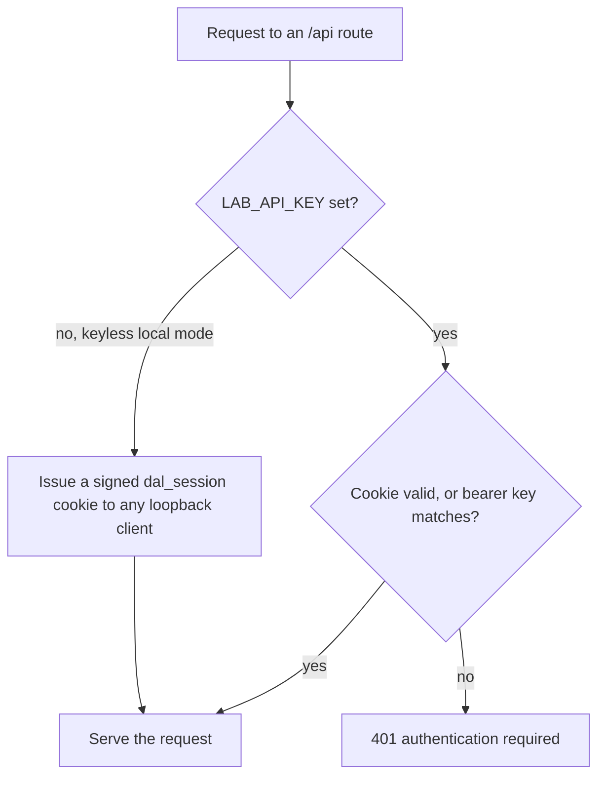
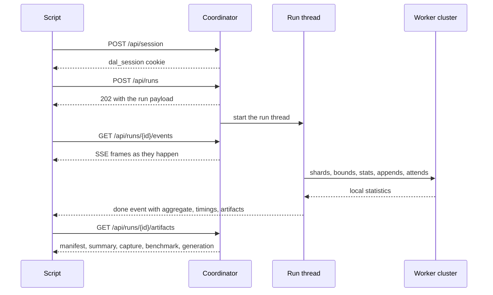

# Coordinator HTTP API: runs, events, and artifacts

Reference for Tessera's `app/main.py` and the run lifecycle in
`distributed_llm/manager.py`. Base URL is always `http://127.0.0.1:<port>`. There
is no OpenAPI or docs endpoint; both are disabled on purpose, so this file is the
contract.

## Authentication

Two modes, selected by `LAB_API_KEY`.

| Mode | `auth_required` | How a client gets in |
|---|---|---|
| Keyless local (default) | `false` | Any loopback GET `/` receives a signed session cookie automatically; scripts can `POST /api/session` with `{"api_key":""}` |
| Key mode | `true` | `POST /api/session` with the key, or send `Authorization: Bearer <LAB_API_KEY>` on every request |

The session cookie is `dal_session`: HMAC-SHA256 signed with
`LAB_SESSION_SECRET`, `HttpOnly`, `SameSite=Strict`, `Path=/`, not `Secure`
(the server is loopback HTTP only), and `max_age = LAB_SESSION_TTL_S` (900 s by
default). Without a secret the server generates a random one per process, so
restarting invalidates every cookie. `SessionSigner.verify` also rejects tokens
issued more than 60 seconds into the future and tokens older than the TTL.

Failed logins are tracked per client IP: 8 failures inside 300 s locks the client
out for 300 s and yields HTTP 429.

The dashboard in keyless mode never asks for a key. If a session expires, the
client silently re-opens one and only shows the key field when the server reports
`auth_required: true`.

Other guards, all middleware: the `Host` header must be in `LAB_ALLOWED_HOSTS`;
unsafe methods must come from a same-origin `Origin`; POST bodies to the JSON API
are capped at `min(LAB_MAX_REQUEST_BYTES, 1 MiB)`; responses carry CSP,
`X-Content-Type-Options: nosniff`, `X-Frame-Options: DENY`, and `no-store`.

## Public endpoints

| Method | Path | Returns |
|---|---|---|
| `GET` | `/` | dashboard HTML, sets a session cookie when appropriate |
| `GET` | `/healthz` | `{"status":"ok","app_version":"11.4.2"}` |
| `GET` | `/readyz` | readiness payload below |
| `GET` | `/api/public-config` | version, `auth_required`, and the limits the form needs |
| `POST` | `/api/session` | opens a session, sets the cookie |
| `POST` | `/api/logout` | deletes the cookie |

```json
// GET /readyz
{"ready":true,"shutting_down":false,"busy":false,"active_run_id":null,
 "free_disk_gb":118.4,"minimum_free_disk_gb":1.0,
 "available_ram_gb":6.21,"app_version":"11.4.2"}
```

`ready` is false while shutting down or when free disk is below
`LAB_MIN_FREE_DISK_GB`. A negative disk or RAM figure means the probe failed, and
the preflight treats unknown as acceptable rather than blocking.

```json
// GET /api/public-config
{"app_version":"11.4.2","auth_required":false,
 "limits":{"min_workers":2,"max_workers":8,"max_context_tokens":1024,
  "default_context_tokens":512,"max_overlap_pct":50.0,"max_prompt_chars":12000,
  "session_ttl_s":900,"max_generation_tokens":4096,"default_max_new_tokens":1000,
  "max_generation_positions":4096,"generation_timeout_s":1800.0,
  "generation_step_timeout_s":30.0}}
```

## Authenticated endpoints

Every route under the `/api` router requires a valid cookie or bearer key, else
401 `authentication required`.

| Method | Path | Notes |
|---|---|---|
| `GET` | `/api/status` | `app_version`, `auth_required`, `metrics`, `current_run` |
| `GET` | `/api/metrics` | metrics block only |
| `POST` | `/api/runs` | starts a run, 202, 409 when busy, 422 on validation, 503 on preflight |
| `GET` | `/api/runs/current` | `{"run": <status payload> or null}` |
| `GET` | `/api/runs/{run_id}` | 404 for an unknown or malformed id |
| `POST` | `/api/runs/{run_id}/cancel` | `{"cancelled": bool}`, false when the run already finished |
| `GET` | `/api/runs/{run_id}/events?after=N` | SSE |
| `GET` | `/api/runs/{run_id}/result` | `summary.json`, 409 before it exists |
| `GET` | `/api/runs/{run_id}/artifacts` | name and byte size for each available artifact |
| `GET` | `/api/runs/{run_id}/artifacts/{name}` | whitelisted download |

Run ids match `^[A-Za-z0-9_-]{8,64}$` and look like
`20261025T011641Z-run-983071bf` (UTC stamp, kind, 8 random hex characters).

### Run request

`POST /api/runs`, unknown fields rejected (`extra="forbid"`):

```json
{
  "prompt": "Explain quicksort in Python.",
  "workers": 4,
  "max_tokens": 512,
  "overlap_pct": 0.0,
  "strategy": "pseudorandom",
  "seed": 42,
  "error_tol": 0.001,
  "safe_gamma": 1.05,
  "generate": true,
  "max_new_tokens": 1000,
  "layers": null,
  "kv_heads": null
}
```

| Field | Default | Bounds |
|---|---|---|
| `prompt` | required | 1 char minimum, `LAB_MAX_PROMPT_CHARS` after validation, must not be whitespace only |
| `workers` | 4 | `LAB_MIN_WORKERS..LAB_MAX_WORKERS` |
| `max_tokens` | 512 | 16..`LAB_MAX_CONTEXT_TOKENS` (capture budget, not the decode window) |
| `overlap_pct` | 0.0 | 0..`LAB_MAX_OVERLAP_PCT` |
| `strategy` | `pseudorandom` | `pseudorandom` or `contiguous` |
| `seed` | 42 | 0..2^31-1 |
| `error_tol` | 1e-3 | schema 0 exclusive..1, validator 1e-9..1 |
| `safe_gamma` | 1.05 | 0..2 |
| `generate` | true | toggles the distributed decode stage |
| `max_new_tokens` | `LAB_DEFAULT_MAX_NEW_TOKENS` | 1..`LAB_MAX_GENERATION_TOKENS` |
| `layers` / `kv_heads` | null | optional subset restriction for quick probes |

`RunConfig.validate` repeats the range checks in a second layer and adds rules the
schema cannot express: the prompt must not be whitespace only or longer than
`LAB_MAX_PROMPT_CHARS`, `error_tol` must land in 1e-9..1, `layers` values must be
below 256 and `kv_heads` values below 64, and neither list may contain duplicates
or non-integers. Two further checks happen later because they need data the
request cannot supply: the partitioner rejects a `contiguous` strategy with fewer
tokens than workers, and the generation stage refuses to start when
`captured prompt tokens + max_new_tokens` exceeds `LAB_MAX_GENERATION_POSITIONS`,
because the tokenizer, not the request, decides the first number.

### Status payload

Everywhere a run is serialized:

```json
{"run_id":"...","status":"running","started_utc":"...","finished_utc":null,
 "error":null,
 "config":{"workers":4,"max_tokens":512,"overlap_pct":0.0,"strategy":"pseudorandom",
  "seed":42,"error_tol":0.001,"safe_gamma":1.05,"generate":true,
  "max_new_tokens":1000,"layers":null,"kv_heads":null},
 "prompt_sha256":"...","last_seq":412}
```

`config` is the public projection: the prompt text never appears in a status
payload, only its SHA-256 and, in the summary, its length in characters.

`status` is one of `running`, `completed`, `failed`, `cancelled`.

### Metrics

`GET /api/metrics` returns `app_version`, server `uptime_s`, run counters
(`started`, `completed`, `failed`, `cancelled`), the `active_run` summary
(`run_id`, `status`, `started_utc`, `elapsed_s`, `workers`, `context_tokens`),
`process_rss_mb`, `available_ram_gb`, `free_disk_gb`, and the enforced limits
including both generation budgets.

## SSE stream

`GET /api/runs/{run_id}/events?after=N` replays buffered events with a sequence
number greater than `N`, then streams live events every 0.2 s, emits a `: ping`
comment every 15 s, and closes with `event: end` once the run finishes. The
buffer holds the last 20,000 events, so a reconnect after a short outage loses
nothing; a very chatty long decode can trim old events.

Each frame is `id: <seq>` plus `data: <json>`, and every payload contains
`run_id` and `seq` plus a `type`.

| `type` | Emitted when | Extra keys |
|---|---|---|
| `run` | accepted, before the thread starts | `config`, `prompt_sha256`, `prompt_chars` |
| `info` | human-readable milestones, cancellation request | `msg` |
| `stage` | lifecycle transitions and forwarded subprocess progress | `stage`, `phase`, plus stage-specific numbers |
| `comm` | worker spawn, ready, request failures inside the cluster | `msg`, `level`, `event`, `worker_id`, `port` |
| `generation` | decode finished or failed | `status`, `method`, `text`, `token_count`, `stop_reason`, `timing_s`, `prefill_s`, `decode_s`, `workers`, `provenance` |
| `error` | any uncaught run failure | `error_type`, `message` |
| `done` | the last event, always | `status`, and on success `aggregate`, `timings`, `artifacts` |

`stage` values, in order: `capture`, `cluster`, `benchmark_done`,
`generation_cluster`, `generation`. The subprocess line protocol is filtered by
stage label, so a `capture` stage event only reaches the stream while capture is
running, and the same event object is what the CLI prints.

## Artifacts

`GET /api/runs/{id}/artifacts/{name}` serves only these names, checks the file
resolves inside the run directory, and returns it as an attachment:

```text
summary.json, manifest.json, benchmark.json, cluster.json, capture.json,
capture.npz, request.json, generation.json, events.jsonl
```

Anything else is 404 `unknown artifact`. Worker logs live under `cluster/workers/`
and `generation_cluster/workers/` and are deliberately not downloadable; they are
on disk for post-mortems. See [06-operations.md](06-operations.md) for what each file
contains and how to verify the manifest.

## Error taxonomy

| Surface | Cause |
|---|---|
| 401 | missing, expired, or bad cookie or bearer key |
| 409 on `POST /api/runs` | a run is already active (`RunBusyError`) |
| 422 on `POST /api/runs` | schema violation or `RunConfig.validate` failure |
| 503 on `POST /api/runs` | `RunManagerError`, for example not enough free disk |
| 404 | unknown run id or artifact |
| 409 on `/result` | no `summary.json` yet |
| 413 | JSON body over the API limit |
| 429 | login lockout |

Inside a run, `CaptureFailure` covers capture and subprocess problems,
`GenerationFailure` covers the decode stage, `BenchmarkError` and
`BenchmarkCancelled` cover the benchmark loop, and `ClusterError` covers worker
lifecycle and transport. The class name is reported verbatim as `error_type` in
the `error` event and in `summary.json`, so a dashboard failure is directly
searchable in the code.

Generation failure fails the run. It is never downgraded to a warning, and a run
that produced attention numbers but no text is recorded as failed.

## How a request is authenticated



The login card in the dashboard follows the same branch: it shows the key field
only when the server reports `auth_required: true`, and in keyless mode an
expired session is re-opened silently instead of prompting.

## Scripted use



```bash
# Keyless local mode: no secret involved.
curl -s -c jar.txt -X POST http://127.0.0.1:8000/api/session \
  -H 'Content-Type: application/json' -d '{"api_key":""}'

curl -s -b jar.txt -X POST http://127.0.0.1:8000/api/runs \
  -H 'Content-Type: application/json' \
  -d '{"prompt":"Hello","workers":2,"max_tokens":64,"max_new_tokens":10}'

curl -s -b jar.txt "http://127.0.0.1:8000/api/runs/current"
```

In key mode, replace the session call with `-H "Authorization: Bearer $LAB_API_KEY"`
or send the real key in the body. `LAB_API_KEY` is a deployment choice, not a
value stored in this repository.
