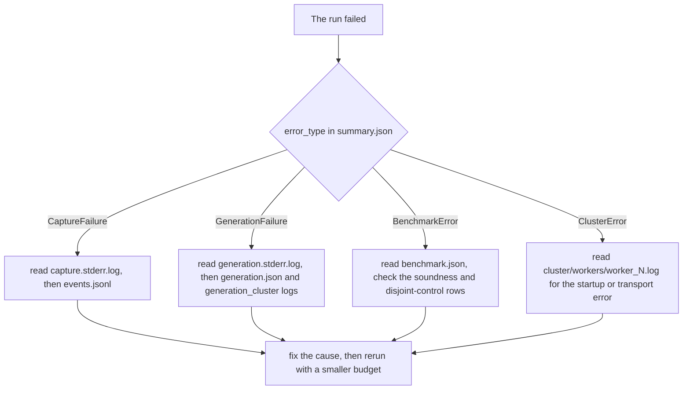

# Operations

Measured on this machine: Windows 11, Python 3.12, CPU only, Qwen2.5-Coder-1.5B
snapshot `df3ce67c` in the local Hugging Face cache. Treat every number here as a
property of that hardware, not of the protocol.

## Starting and stopping

```bash
launch.bat fast          # Windows, skip dependency install
./launch.sh fast         # Linux and macOS
launch.bat               # install pinned requirements, then start
```

Both bind `127.0.0.1:8000` (`LAB_PORT` overrides on the shell launcher only) and
never enable `--reload`, because reload would kill live worker child processes.

Sanity checks before a run:

```bash
curl -s http://127.0.0.1:8000/healthz    # app is up
curl -s http://127.0.0.1:8000/readyz     # disk headroom, busy flag, free RAM
```

Stopping the server mid-run leaves child worker processes. On Windows, `taskkill`
the uvicorn tree; on POSIX the workers are in the process group. The manager
cancels and joins the run thread on shutdown with a 20 s budget, and each
`WorkerCluster.shutdown()` terminates then kills its children, but a hard kill
skips all of that. `output/runs/<id>/` still holds the artifacts written so far,
and the manifest simply will not exist.

## What a run costs

Benchmark stage, measured 2026-10-24 with 243 context tokens and 4 workers:

| Stage | Wall | Peak RSS |
|---|---|---|
| Capture | about 26 s | 594 MB |
| Benchmark | about 9 s | workers plus the shard copies, roughly 72 MB per worker |

Generation stage, measured 2026-10-25 on run `20261025T011641Z-run-983071bf`: 3
workers, capture budget 1024, prompt tokenized to 1021 tokens, 1000 new tokens
requested.

| Metric | Value |
|---|---|
| Status | completed |
| Stop reason | `max_new_tokens`, the model never reached end of sequence |
| Prefill | 169.216 s |
| Decode | 7933.702 s, 7.93 s per token |
| Generation total | 9188.21 s (about 2 h 33 m) |
| Run duration | 9271.625 s (about 2 h 34 m) |
| Decoder peak RSS | 728.6 MB |
| Output | 4821 characters |

The dashboard warns 8 to 15 seconds per token; 7.93 s/token is the fast end, at
the low worker count. Decoding is dominated by reloading all 28 layers from
`model.safetensors` for every token, which is the deliberate price for keeping the
decoder inside this machine's RAM. More workers do not make it faster on one
machine; they add HTTP fan-out. Plan budgets from the token count, not from the
worker count.

Practical consequence: the 1000-token default can run for hours. For a quick check,
set the field to 20 or 50, or press Cancel; the model will usually not stop on its
own.

## RAM admission

Two separate checks, both using `psutil` and both treating a failed probe
(`-1.0`) as unknown rather than as a refusal.

Cluster spawn, per cluster:

```
needed = SPAWN_HEADROOM_GB + workers * ESTIMATED_WORKER_RSS_MB
       = 0.25 GB + 72 MB per worker
```

Generation admission, after the workers are already up, so the free figure already
excludes them:

```
kv_bytes  = positions * layers * kv_heads * head_dim * 4 * 2
needed    = kv_bytes * 1.25 / 1024^3 + LAB_GENERATION_DECODER_HEADROOM_GB
```

The KV total is charged once for the cluster, not once per worker, because strided
ownership places each position on exactly one worker. For the measured run above,
2021 positions give 115,892,224 bytes, about 110 MiB, so admission asked for
roughly 0.14 GB of KV growth plus 0.7 GB of decoder headroom.

Rejections name the exact shortfall (the figures below illustrate the message
shape, not a specific run):

```
distributed generation needs about 1.92 GB of free RAM (KV 1.22 GB across 4
workers, decoder 0.70 GB), only 0.83 GB is available. Lower the generation
token budget or the worker count.
```

```
starting 8 workers needs about 0.81 GB of free RAM, only 0.42 GB is available.
Lower the worker count.
```

On a RAM-limited machine, 2 to 4 workers is the comfortable range. Eight workers
cost roughly 576 MB of resident Python before any tensor is uploaded.

## Failure modes and what they mean



| Symptom | Where | What to do |
|---|---|---|
| 409 on `POST /api/runs` | coordinator | one run at a time; wait, or cancel the active one |
| `prompt_too_long` | capture | the prompt needs more tokens than `max_tokens`; raise it or shorten the prompt. Silent truncation is never benchmarked |
| `capture exceeded the 900s timeout` | manager watchdog | another process was competing for CPU; check for a stale worker cluster |
| `generation exceeded the N s timeout` | manager watchdog | either the decoder wedged or the budget is too small for the requested tokens; the formula is in [05-configuration.md](05-configuration.md) |
| `410 session expired` from a worker | worker TTL | the cluster was idle past `LAB_SESSION_TTL_S`; every successful call refreshes the clock, so this means a wedged stage, not a slow decode |
| `worker received positions it does not own` (403) | generation worker | routing bug or a hand-crafted request; the strided invariant did the job it was designed to do |
| `append conflicts with stored K/V` (409) | generation worker | a retry delivered different bytes for a position already cached; the run is aborted rather than silently corrupted |
| `generation cache is full` (422) | generation worker | the requested budget plus prompt exceeded the preallocated window |
| `visible key accounting mismatch` | decoder | invariant 1 failed; treat as a protocol defect and report the run id |
| `owns X positions but should own Y` | decoder | invariant 2 failed; same |
| `no retained set satisfied the tolerance, including all workers` | benchmark | the certificate is unsatisfied at full retention, which is impossible by construction; a bound or correction bug |
| `disjoint control does not match dense attention` | benchmark | partition or merge defect that the certificate cannot see; this check exists for exactly this case |
| `soundness check failed` | benchmark | actual error exceeded certified error plus the float64 allowance; the claim is broken |
| `model.safetensors is missing under ...` | decoder | the pinned snapshot is absent or pruned; re-download it, the framework never fetches implicitly |
| `only X GB free on the artifacts volume` | manager | `LAB_MIN_FREE_DISK_GB`, checked at run start and again before the benchmark |

A generation failure fails the run. Attention numbers already computed stay in
`benchmark.json`, but `summary.json` records `status: "failed"` with the error
type and message.

## Reading the artifacts

```bash
cd output/runs/<run_id>
python - <<'PY'
import hashlib, json, pathlib
m = json.loads(pathlib.Path("manifest.json").read_text(encoding="utf-8"))
for row in m["artifacts"]:
    p = pathlib.Path(row["name"])
    digest = hashlib.sha256(p.read_bytes()).hexdigest()
    print("ok " if digest == row["sha256"] and p.stat().st_size == row["bytes"] else "BAD",
          row["name"], row["bytes"])
PY
```

The manifest hashes every file in the run directory recursively, including worker
logs, and is written last so it never has to hash itself. A failed run writes a
failure summary plus a manifest too, so partial provenance is still verifiable.

Useful inspection order after a bad run:

1. `summary.json`, the `error` block, which carries the exception class name
2. `events.jsonl`, the ordered timeline with sequence numbers, the same events the
   dashboard streamed
3. `capture.stderr.log` or `generation.stderr.log`, raw subprocess stderr
4. `cluster/workers/worker_<id>.log` or `generation_cluster/workers/...`, the
   worker-side view, which is where a 4xx that the client retried shows up
5. `cluster.json` and the `transport` block of `generation.json` for per-worker
   calls, retries, failures, bytes, and wall time

Worker logs are on disk but are not downloadable through the API; the artifact
endpoint serves a fixed whitelist only.

## Reproducing a run by hand

```bash
python -m distributed_llm.capture_runner \
    --prompt-file prompt.txt --max-tokens 512 \
    --out output/cli/capture.npz --meta output/cli/capture.json

python -m distributed_llm.benchmark_runner \
    --capture output/cli/capture.npz --meta output/cli/capture.json \
    --out-dir output/cli --workers 4 --overlap 0 --eps 1e-3
```

Generation needs a live cluster, so it is normally driven through the API. The
runner reads `LAB_GEN_CONNECTION` (session id, bearer token, worker URLs) and can
be pointed at a manually started set of workers for debugging:

```bash
LAB_WORKER_TOKEN=<24+ chars> LAB_SESSION_ID=<8+ chars> LAB_WORKER_ID=0 \
    python -m distributed_llm.worker_node 43101
```

Both CLI runners emit the same JSON-lines event protocol the manager parses, so a
server failure and a CLI failure carry the same taxonomy. `--allow-truncation`
exists for offline analysis of oversized captures and is never used by the server.

## Cancellation

`POST /api/runs/{id}/cancel` sets the run's cancel event. The benchmark checks it
between units and between retention steps; the generation subprocess is terminated
by the manager, and clusters shut down in `finally` blocks either way. A
cancelled run gets `status: "cancelled"`, a failure summary, and a manifest.

## Resetting to a known state

```bash
curl -s -b jar.txt http://127.0.0.1:8000/readyz   # busy?
curl -s -b jar.txt http://127.0.0.1:8000/api/runs/current
```

If the server was killed with children alive, check for leftover worker processes
before starting another run, since a stale cluster consumes the RAM that new
admission needs:

```bash
tasklist | grep -i python        # Windows
pgrep -af distributed_llm.worker_node
```

Run output accumulates in `output/runs/`. Nothing is deleted automatically; the
in-memory record map trims to 32 runs, but the directories stay until you remove
them. Prompts are removed unless `LAB_STORE_PROMPTS=true`.
