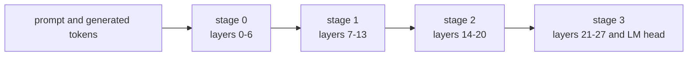

# Roadmap

Distributed Attention is a side project with a framework target: run LLM
inference across cheap, heterogeneous edge devices, starting with the part that
scales worst. This document records what already runs, what each next stage has
to deliver, and which questions are still open. The README carries the same
items in short checkbox form.

A stage is not finished because the code exists. It is finished when the
distributed result is verified against the monolithic result on real weights, the
cost is measured on the reference machine, and the failure modes are typed and
documented.

## Where the framework is today

| Capability | State |
|---|---|
| Attention capture | fp32 Q/K/V from the pinned snapshot, streamed one layer at a time, verified against Hugging Face |
| Partitioned attention | hash or contiguous chunks, optional overlap, Cauchy-Schwarz block bounds |
| Certified pruning | omitted-mass certificate, greedy retention, safety factor, disjoint control |
| Exact merge | float64 log-sum-exp with multiplicity correction |
| Distributed decode | strided KV ownership, per-unit caches, per-worker causal mask, exact merge |
| Run isolation | fresh ports, session ids, bearer tokens and worker processes per run |
| Artifacts | request, capture, benchmark, cluster, generation, events, SHA-256 manifest |
| API and dashboard | loopback-only FastAPI, SSE with replay, two auth modes, artifact whitelist |
| Tests | 78 collected, oracles against dense attention and `Qwen2ForCausalLM` |

Measured on the reference machine (Windows 11, Python 3.12, CPU only):

| Result | Value |
|---|---|
| Exact merge error, 4 workers, 243 tokens, 56 units | 4.26e-14 relative |
| Disjoint control error | 4.26e-14 relative |
| Certified pruning at `head_dim = 128` | never triggers; net FLOP savings -1.85 percent |
| 1000-token distributed decode, 3 workers | completed, 7.93 s per token, decoder peak 728.6 MB |

What is not distributed yet: only attention runs on the workers. The decoder
streams all 28 layers through the coordinator process, and every worker is a
local process rather than a remote node. The worker contract itself already
fits a remote deployment, since it is plain HTTP with a per-run bearer token and
no shared memory, but the transport is loopback and unencrypted.

## Stage 1: attention

Attention is distributed and exact. The open work is making the pruning path pay
for itself.

The 2026-10-24 benchmark showed the blocker: the Cauchy-Schwarz block bound
stays at 9.617 while the actual relative error falls to 0.082 with three of four
workers retained, so the certificate refuses to prune and the net FLOP saving is
negative. Tighter bounds are the first todo.

- [ ] a bound tight enough to prune at `head_dim = 128`, computed from the same
      per-block metadata the coordinator already receives
- [ ] retention that produces a positive net FLOP saving, measured, not asserted
- [ ] the overlap correction exercised beyond the disjoint control
- [ ] pruning applied inside the decode path, which currently decodes at full
      retention

Open question: any tighter bound must stay privacy-preserving and
bandwidth-cheap. Computing the exact maximum inner product would mean shipping
every key to the coordinator, which removes the reason to partition.

## Stage 2: the rest of the layer stack

Three splits are on the table, and they are not exclusive.

| Split | What moves | What it buys | What it costs |
|---|---|---|---|
| Attention (today) | Q/K/V | fits long contexts, exact merge | one HTTP fan-out per layer |
| Pipeline | layer ranges per worker | weights fit on small devices | serialized stage latency per token |
| Tensor | heads and MLP columns per worker | more nodes per layer | collective reduction per layer |

Pipeline parallelism is the natural next step because it reuses the existing
worker process contract: a worker would own a contiguous range of layers and the
activations between stages travel over the same authenticated, size-capped binary
channel that already carries KV. A hidden state is 1536 float32 values, about
6 KB per token, so bandwidth is not the constraint; serialization is. A pipeline
does not make a single sequence faster, it makes the weights fit, which is the
edge-device problem.

Target layout for the next stage, not implemented yet:

- [ ] decide which non-attention work moves: RMSNorm, MLP, embeddings, LM head
- [ ] activation transport with the same auth, size caps and typed errors as KV
- [ ] micro-batching and scheduling that keep every stage busy
- [ ] token-for-token equivalence against the monolithic model, as attention
      already has against Hugging Face
- [ ] KV cache placement that follows the layer-owning worker
- [ ] per-stage memory model and admission check

## Stage 3: edge deployment

The current deployment is one host with loopback workers. The framework becomes
usable on edge devices when workers can be placed, reached and trusted remotely.

- [ ] one container image per role: worker and coordinator
- [ ] orchestration: discovery, placement, health checks, restart, drain
- [ ] multi-host transport with TLS and per-node credentials
- [ ] memory- and bandwidth-aware placement across heterogeneous devices
- [ ] sampling and continuous batching beyond greedy decode
- [ ] measurements on real edge hardware instead of loopback processes

Open questions: which scheduler owns placement (the coordinator today), how
workers are authenticated when there is no shared loopback (mutual TLS plus a
per-run token), how a dead stage fails a run without leaving partial artifacts,
and whether quantization parity is required before a stage can claim exactness.

## How each stage is verified

- Numerical oracles first: dense attention for the attention path,
  `Qwen2ForCausalLM` for whole-model output. A stage that cannot match the
  monolithic result is not done.
- Costs are measured on the reference machine and recorded in
  [06-operations.md](06-operations.md), including the negative results.
- Every new failure mode gets a typed error, a status code where it crosses
  HTTP, and a test that produces it.
